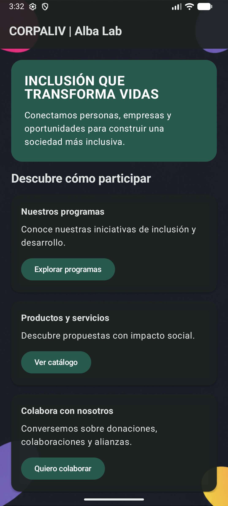
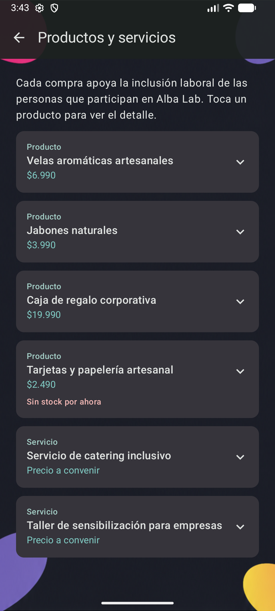
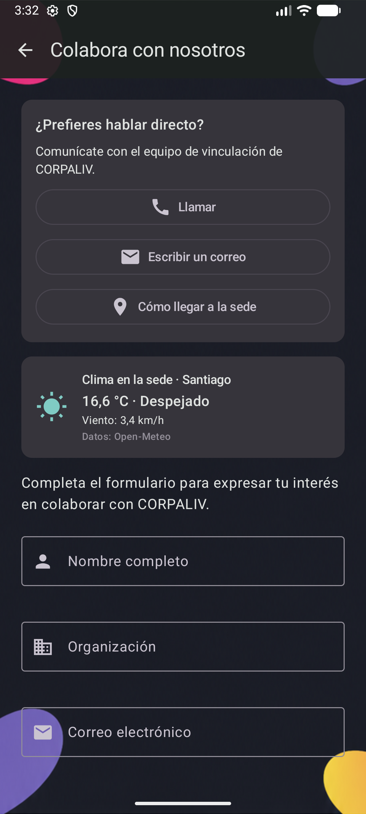
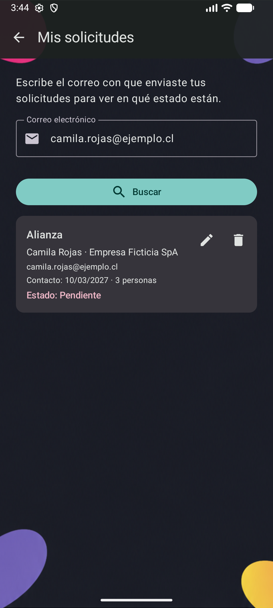
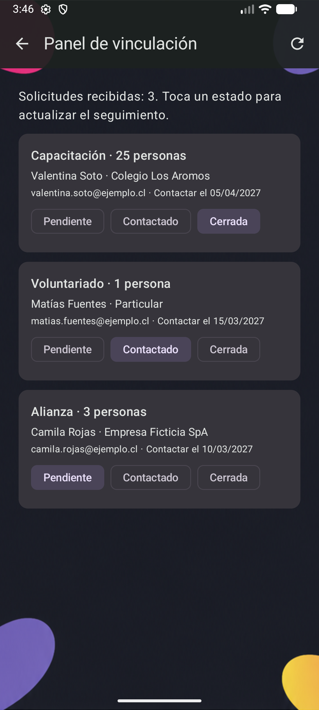
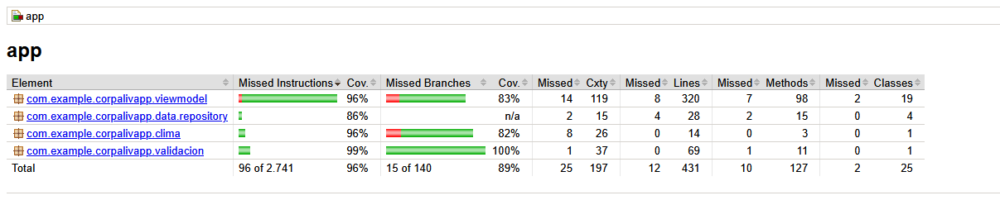
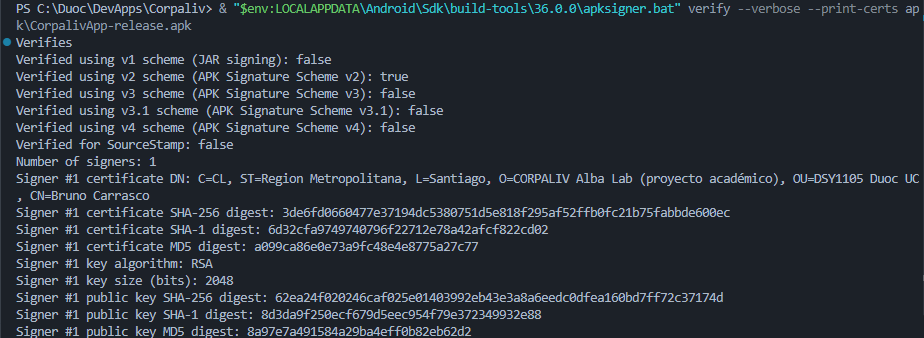
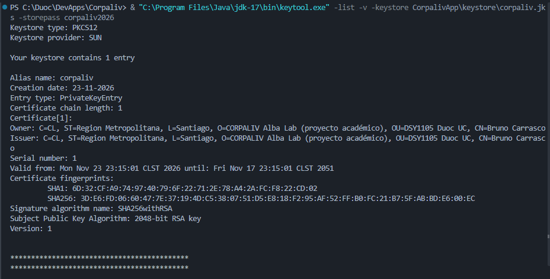

# CorpalivApp

Aplicación móvil para **CORPALIV | Alba Lab**, organización que trabaja por la inclusión
social y laboral de personas con discapacidad múltiple. La app reúne en un solo lugar los
programas de inclusión, el catálogo de productos y servicios con impacto social y un
formulario para registrar la intención de colaborar (donación, alianza, voluntariado,
compra de productos o capacitación). Además, el equipo de vinculación de CORPALIV puede
revisar las solicitudes recibidas y actualizar su estado.

Proyecto de la asignatura **DSY1105 Desarrollo de Aplicaciones Móviles** (Duoc UC).

## Integrantes

- Bruno Carrasco
- Fernanda Céspedes

## Estructura del repositorio

```
├── CorpalivApp/                  App Android (Kotlin + Jetpack Compose, MVVM)
│   ├── app/src/main/...          Código de la app
│   ├── app/src/test/...          Pruebas unitarias
│   ├── keystore/corpaliv.jks     Llave de firma del APK
│   └── keystore.properties       Configuración de la firma
├── Backend/
│   ├── ms-productos/             Microservicio de productos y servicios (puerto 8081)
│   ├── ms-programas/             Microservicio de programas de inclusión (puerto 8082)
│   ├── ms-colaboraciones/        Microservicio de solicitudes de colaboración (puerto 8083)
│   ├── sql/crear-bases.sql       Script de respaldo para crear las bases de datos
│   └── iniciar-microservicios.bat  Arranca los tres microservicios
├── apk/CorpalivApp-release.apk   APK firmado (release)
└── docs/                         Capturas y evidencias
```

## Tecnologías

| Parte | Tecnologías |
|---|---|
| App | Kotlin, Jetpack Compose, Material 3, ViewModel + StateFlow (MVVM), Retrofit 3, Gson, OkHttp |
| Microservicios | Java 17, Spring Boot 4.2, Spring Web, Spring Data JPA, Bean Validation, Maven Wrapper |
| Base de datos | MySQL de XAMPP (MariaDB), una base por microservicio |
| API externa | [Open-Meteo](https://open-meteo.com) (clima actual, sin clave) |
| Pruebas | JUnit 4, MockK, kotlinx-coroutines-test, JaCoCo |

## Funcionalidades

**Para donantes, empresas y colaboradores**
- **Inicio** con el propósito de CORPALIV y acceso a cada sección.
- **Programas de inclusión** de la organización.
- **Catálogo de productos y servicios** obtenido desde `ms-productos`: categoría, precio en
  pesos ("Precio a convenir" para servicios), disponibilidad y detalle expandible.
- **Formulario "Colabora con nosotros"** con validación por campo (nombre, organización,
  correo, tipo de colaboración, cantidad de personas, fecha con calendario y aceptación).
  La solicitud se envía a `ms-colaboraciones` y se confirma con una **notificación**.
- **Contacto directo:** llamar, escribir un correo o abrir el mapa de la sede.
- **Clima actual en la sede** desde la API externa Open-Meteo.
- **Mis solicitudes:** búsqueda por correo, estado de cada solicitud, **edición** y
  **eliminación**.

**Para el equipo de vinculación**
- **Panel de vinculación:** todas las solicitudes recibidas y cambio de estado
  (Pendiente, Contactado o Cerrada).

**Manejo de errores:** cada pantalla muestra un estado de carga, un mensaje claro si no hay
conexión o el servidor responde con error, y un botón **Reintentar**.

### Capturas

| Inicio | Catálogo | Colabora con nosotros |
|---|---|---|
|  |  |  |

| Mis solicitudes | Panel de vinculación |
|---|---|
|  |  |

## Arquitectura

**App (MVVM):**
```
Pantalla (Compose) ──► ViewModel (StateFlow) ──► Repository ──► ApiService (Retrofit) ──► microservicio / API externa
```
- Las pantallas solo muestran el estado y avisan las acciones al ViewModel.
- Los ViewModels validan, llaman al repositorio y manejan los errores de red.
- Los repositorios aíslan de dónde vienen los datos.

**Microservicios (en capas):**
```
Controller (endpoints REST) ──► Service (lógica) ──► Repository (Spring Data JPA) ──► MySQL
```
Cada microservicio tiene su propia base de datos (`corpaliv_productos`,
`corpaliv_programas`, `corpaliv_colaboraciones`) y responde los errores en JSON:
**400** si los datos no son válidos (con el mensaje de cada campo) y **404** si el id no existe.

## Endpoints

### Microservicios propios

**ms-productos** · `http://localhost:8081`

| Método | Ruta | Descripción |
|---|---|---|
| GET | `/api/productos` | Lista todos los productos y servicios |
| GET | `/api/productos/{id}` | Obtiene uno por id |
| POST | `/api/productos` | Crea un producto (201) |
| PUT | `/api/productos/{id}` | Actualiza un producto |
| DELETE | `/api/productos/{id}` | Elimina un producto (204) |

**ms-programas** · `http://localhost:8082`

| Método | Ruta | Descripción |
|---|---|---|
| GET | `/api/programas` | Lista todos los programas |
| GET | `/api/programas/{id}` | Obtiene uno por id |
| POST | `/api/programas` | Crea un programa (201) |
| PUT | `/api/programas/{id}` | Actualiza un programa |
| DELETE | `/api/programas/{id}` | Elimina un programa (204) |

**ms-colaboraciones** · `http://localhost:8083`

| Método | Ruta | Descripción |
|---|---|---|
| GET | `/api/colaboraciones` | Lista todas las solicitudes (la más nueva primero) |
| GET | `/api/colaboraciones?correo={correo}` | Lista las solicitudes de un correo |
| GET | `/api/colaboraciones/{id}` | Obtiene una por id |
| POST | `/api/colaboraciones` | Crea una solicitud; siempre parte en estado "Pendiente" (201) |
| PUT | `/api/colaboraciones/{id}` | Edita los datos de la solicitud (no cambia el estado) |
| PATCH | `/api/colaboraciones/{id}/estado` | Cambia el estado: `{ "estado": "Contactado" }` |
| DELETE | `/api/colaboraciones/{id}` | Elimina una solicitud (204) |

Desde el emulador, la app usa `10.0.2.2` en lugar de `localhost` (es la dirección del PC
vista desde el emulador).

### API externa

**Open-Meteo** · `https://api.open-meteo.com`

| Método | Ruta | Uso en la app |
|---|---|---|
| GET | `/v1/forecast?latitude=-33.45&longitude=-70.66&current=temperature_2m,weather_code,wind_speed_10m&timezone=America/Santiago` | Clima actual en la sede (temperatura, estado del tiempo y viento) |

## Ejecutar el backend con Docker

Abre Docker Desktop con contenedores Linux, o usa Docker Engine con el plugin Docker Compose.
Desde la raíz del repositorio, ejecuta:

```powershell
cd Backend
docker compose up --build -d
docker compose ps
```

Compose compila los tres microservicios con Java 17 e inicia MariaDB con una base por
servicio. La primera compilación descarga las imágenes y dependencias. Cuando los
servicios hayan arrancado, abre estas rutas para comprobar que responden:

- Productos: [localhost:8081/api/productos](http://localhost:8081/api/productos)
- Programas: [localhost:8082/api/programas](http://localhost:8082/api/programas)
- Colaboraciones: [localhost:8083/api/colaboraciones](http://localhost:8083/api/colaboraciones)

Para abrir la app, sigue el paso **3. App** de la sección siguiente. El emulador usa
`10.0.2.2` con los mismos puertos.

Para ver los logs o detener los contenedores, ejecuta desde `Backend`:

```powershell
docker compose logs -f
docker compose down
```

Sal de la vista de logs con Ctrl+C. El volumen de MariaDB conserva los datos al
ejecutar `docker compose down`. Usa esta configuración y sus credenciales para
desarrollo local.

## Pasos para ejecutar

### Requisitos
- **JDK 17** (revisar con `java -version`). Maven no hace falta: cada microservicio trae Maven Wrapper.
- **XAMPP** con MySQL (MariaDB).
- **Android Studio** con el SDK de Android 37 y un emulador.
- Conexión a internet la primera vez (se descargan las dependencias).

### 1. Base de datos
1. Abrir el **XAMPP Control Panel** y presionar **Start** en **MySQL**.
2. No hace falta crear nada: cada microservicio crea su base de datos y sus tablas al
   arrancar, y carga datos de ejemplo. Si fallara, ejecutar `Backend/sql/crear-bases.sql`
   en phpMyAdmin.
3. Se usa el usuario `root` sin contraseña (el de XAMPP por defecto). Si el MySQL tiene
   otra clave, definir las variables de entorno `DB_USER` y `DB_PASSWORD` antes de arrancar.

### 2. Microservicios
Opción rápida: doble clic en **`Backend/iniciar-microservicios.bat`**. Se abre una ventana
por microservicio.

Opción manual, una terminal por microservicio:
```powershell
cd Backend\ms-productos
.\mvnw.cmd spring-boot:run
```
(repetir en `ms-programas` y `ms-colaboraciones`).

Cada ventana debe terminar con `Started ...Application`. Para comprobarlo, abrir en el
navegador http://localhost:8081/api/productos, http://localhost:8082/api/programas y
http://localhost:8083/api/colaboraciones.

### 3. App
1. En Android Studio: **File → Open** → carpeta **`CorpalivApp`**. Esperar el Gradle Sync.
2. Elegir el emulador y presionar **▶ Run**.
3. En Android 17, aceptar el permiso de **dispositivos cercanos / red local**: sin él,
   Android bloquea la conexión con los microservicios del PC.

Para usar un teléfono físico, cambiar `10.0.2.2` por la IP del PC en
`data/remote/ApiConfig.kt` y en `res/xml/network_security_config.xml` (el PC y el
teléfono deben estar en la misma red Wi-Fi).

### 4. Instalar el APK firmado (sin compilar)
```powershell
adb uninstall com.example.corpalivapp
adb install apk\CorpalivApp-release.apk
```

## Pruebas unitarias

70 pruebas sobre la lógica de la app: validador del formulario, traductor del clima,
repositorios y ViewModels (éxito, sin conexión y error HTTP). Los repositorios y la API se
reemplazan por *mocks* con MockK, así que las pruebas no necesitan los microservicios.

```powershell
cd CorpalivApp
.\gradlew.bat reporteCobertura
```
Reporte: `CorpalivApp/app/build/reports/jacoco/reporteCobertura/html/index.html`.
Cobertura de la lógica (ViewModels, repositorios, validación y clima): **97% de líneas**.



## APK firmado

- APK: [`apk/CorpalivApp-release.apk`](apk/CorpalivApp-release.apk)
- Llave: [`CorpalivApp/keystore/corpaliv.jks`](CorpalivApp/keystore/corpaliv.jks) (alias `corpaliv`, válida por 25 años)
- Configuración: [`CorpalivApp/keystore.properties`](CorpalivApp/keystore.properties) y
  `signingConfigs` en [`CorpalivApp/app/build.gradle.kts`](CorpalivApp/app/build.gradle.kts)

Pasos con que se generó:
1. Android Studio → **Build → Generate Signed App Bundle or APK → APK** → **Create new...**
   para crear la llave `corpaliv.jks`.
2. `signingConfigs.release` en `app/build.gradle.kts` lee `keystore.properties` y firma el
   APK de release; R8 lo optimiza y `keepRules/rules.keep` conserva los modelos JSON.
3. `.\gradlew.bat assembleRelease` genera el APK firmado.
4. Se verificó con `apksigner verify --print-certs` y se probó en el emulador.

**Firma del APK** (`apksigner verify --print-certs`):



**Llave** (`keytool -list -v -keystore corpaliv.jks`):



> La llave y sus contraseñas se incluyen en el repositorio porque la evaluación lo pide.
> En un proyecto real nunca se suben: se guardan fuera del repositorio.
